# Django-Db-Mailer

[](https://pypi.org/project/django-db-mailer/)
[](https://pypi.org/project/django-db-mailer/)
[](https://django-db-mailer.readthedocs.org/)
[](LICENSE)

Documentation available at [Read the Docs](https://django-db-mailer.readthedocs.io/).

## What's that

A Django package for sending emails, push notifications, SMS, and TTS messages using Django templates stored in the database.

Out of the box, it integrates with Celery for background sending. You can build reports from logs grouped by category and slug. Recipient groups and sending via model signals are available out of the box. The package can also be used as a standalone HTTP service from any programming language.

## Installation

1.  Using pip:

``` bash
$ pip install -U django-db-mailer
```

2.  Add the `dbmail` application to `INSTALLED_APPS` in your settings file (usually `settings.py`)
3.  Sync database (`./manage.py migrate`).

## Mail API

``` python
from dbmail.models import MailTemplate
from dbmail import send_db_mail

# New dbmail template
MailTemplate.objects.create(
    name="Site welcome template",
    subject="[{{prefix}}] Welcome {{full_name}}!",
    message="Hi, {{username}}. Welcome to our site.",
    slug="welcome",
    is_html=False,
)

# Send message with created template
send_db_mail(
    # slug defined on the DB template
    'welcome',

    # recipient can be a list, a comma-separated string, or a single address
    # 'user1@example.com' or 'user1@example.com, user2@example.com' or
    # ['user1@example.com', 'user2@example.com'] or a Mail group slug string
    'user1@example.com',

    # All *args are exposed in the template context
    {
        'username': request.user.username,
        'full_name': request.user.get_full_name(),
        'signup_date': request.user.date_joined,
        'prefix': "DbMail",
    },

    # You can access all model fields. For M2M and FK fields, use the model name
    MyModel.objects.get(pk=1),

    # Optional kwargs:
    # backend='dbmail.backends.mail',
    # provider='apps.utils.some.mail.provider',
    # from_email='from@example.com'
    # cc=['cc@example.com'],
    # bcc=['bcc@example.com'],
    # user=User.objects.get(pk=1),
    #
    # language='ru',
    #
    # attachments=[(filename, content, mimetype)],
    # files=['hello.jpg', 'world.png'],
    # headers={'Custom-Header':'Some value'},
    #
    # queue='default',
    # retry_delay=300,
    # max_retries=3,
    # retry=True,
    # time_limit=30,
    # send_after=60,
    #
    # use_celery=True,
)
```

## Sms API

``` python
from dbmail import send_db_sms


send_db_sms(
    # slug defined on the DB template
    'welcome',

    # recipient can be a list, a comma-separated string, or a single number
    # '+79031234567' or '+79031234567, +79031234568' or
    # ['+79031234567', '+79031234568'] or a Mail group slug string
    '+79031234567',

    # All *args are exposed in the template context
    {
        'username': request.user.username,
        'full_name': request.user.get_full_name(),
        'signup_date': request.user.date_joined
    },

    # You can access all model fields. For M2M and FK fields, use the model name
    MyModel.objects.get(pk=1),

    # Optional kwargs:
    # backend='dbmail.backends.sms',
    # provider='dbmail.providers.nexmo.sms',
    # from_email='DBMail'
    # user=User.objects.get(pk=1),
    #
    # language='ru',
    #
    # queue='default',
    # retry_delay=300,
    # max_retries=3,
    # retry=True,
    # time_limit=30,
    # send_after=60,
    #
    # use_celery=True,
)
```

## Text to speech API

``` python
from dbmail import send_db_tts


send_db_tts(
    # slug defined on the DB template
    'welcome',

    # recipient can be a list, a comma-separated string, or a single number
    # '+79031234567' or '+79031234567, +79031234568' or
    # ['+79031234567', '+79031234568'] or a Mail group slug string
    '+79031234567',

    # All *args are exposed in the template context
    {
        'username': request.user.username,
        'full_name': request.user.get_full_name(),
        'signup_date': request.user.date_joined
    },

    # You can access all model fields. For M2M and FK fields, use the model name
    MyModel.objects.get(pk=1),

    # Optional kwargs:
    # backend='dbmail.backends.tts',
    # provider='dbmail.providers.nexmo.tts',
    # from_email='DBMail'
    # user=User.objects.get(pk=1),
    #
    # language='ru',
    #
    # queue='default',
    # retry_delay=300,
    # max_retries=3,
    # retry=True,
    # time_limit=30,
    # send_after=60,
    #
    # use_celery=True,
)
```

*Text to speech is supported by the default provider, but may not be supported by yours.*

## Push notification API

``` python
from dbmail import send_db_push


send_db_push(
    # slug defined on the DB template
    'welcome',

    # recipient can be a list, a comma-separated string, or a single device token
    # '34cc3e5f...' or '34cc3e5f..., 34cc3e5f...' or
    # ['34cc3e5f...', '34cc3e5f...'] or a Mail group slug string
    '34cc3e5f0d2abf2ca0f9af170bd8cd2372a22f8c',

    # All *args are exposed in the template context
    {
        'username': request.user.username,
        'full_name': request.user.get_full_name(),
        'signup_date': request.user.date_joined
    },

    # You can access all model fields. For M2M and FK fields, use the model name
    MyModel.objects.get(pk=1),

    # Optional kwargs:
    # backend='dbmail.backends.push',
    # provider='dbmail.providers.prowl.push',
    # event='Server is down!',
    # from_email='ConsoleApp'
    # user=User.objects.get(pk=1),
    #
    # language='ru',
    #
    # queue='default',
    # retry_delay=300,
    # max_retries=3,
    # retry=True,
    # time_limit=30,
    # send_after=60,
    #
    # use_celery=True,
)
```

## DBMail Backends

By default, `django-db-mailer` ships with four built-in backends (Mail, SMS, TTS, Push). Nothing prevents you from writing your own to handle whatever you need.

## DBMail Providers

The package bundles built-in providers for the most popular services. They work with the built-in backends without any extra dependencies.

**Push notifications for mobile apps:**

- Apple APNs/APNs2
- Google GCM
- Microsoft Tile/Toast/Raw
- BoxCar
- Parse

**Browser notifications:**

- GCM (Desktop: Google Chrome, FireFox; Mobile: Google Chrome on Android)
- APNs (Desktop: Safari)
- Centrifugo
- PubNub
- BoxCar
- PushAll

**Notifications for team:**

- Slack/Mattermost
- Boxcar
- Prowl
- Pushover
- PushAll

**SMS notifications:**

- Nexmo
- Twilio
- IQsms
- SmsAero
- SmsBliss

**Mail notifications:**

- SendinBlue
- Any, which designed as django email backend

*Provider settings are documented in the project docs.*

## Demo installation

**Docker Compose (recommended)**

``` bash
$ git clone --depth 1 https://github.com/LPgenerator/django-db-mailer.git db-mailer
$ cd db-mailer
$ docker compose up -d
$ docker compose exec web python demo/manage.py bootstrap_demo
```

The `docker-compose.yml` brings up postgres, redis, the Django app and a
celery worker. The `web` service is bound to `127.0.0.1:8000`.

**Local virtualenv**

``` bash
$ git clone --depth 1 https://github.com/LPgenerator/django-db-mailer.git db-mailer
$ cd db-mailer
$ python -m venv .venv && source .venv/bin/activate
$ pip install -e ".[dev,test,demo,celery]"
$ cd demo
$ python manage.py migrate --noinput
$ DJANGO_SUPERUSER_PASSWORD=admin python manage.py bootstrap_demo
$ python manage.py runserver &
$ celery -A demo worker -l info -Q default &
```

Open Shell:

``` bash
$ python manage.py shell_plus --print-sql
```

Create new template:

``` python
from dbmail.models import MailTemplate
from dbmail import send_db_mail

MailTemplate.objects.create(
    name="Site welcome template",
    subject="Welcome",
    message="Welcome to our site. We are glad to see you.",
    slug="welcome",
    is_html=False,
)
```

Try to send test email with created template (without celery):

``` python
send_db_mail('welcome', 'user@example.com', use_celery=False)
```

Send email using celery:

``` python
send_db_mail('welcome', 'user@example.com')
```

Check mail logs:

``` python
from pprint import pprint
from django.forms.models import model_to_dict
from dbmail.models import MailLog

pprint([model_to_dict(obj) for obj in MailLog.objects.all()])
```

Open <http://127.0.0.1:8000/admin/dbmail/> in your browser (login `admin` / `admin`).

## Additional information

**Revisions**

To enable template revisions, install `django-reversion`.
Find information about compatibility with your Django versions [here](http://django-reversion.readthedocs.org/en/latest/django-versions.html).

**Editor**

To enable a rich-text editor, install and configure `django-tinymce` or `django-ckeditor`.

**Theme**

`django-db-mailer` supports the `django-grappelli` skin out of the box (Grappelli 4.x for Django 4.2+).

**Queue**

Install and configure Celery 5.4+ for prioritised background sending. Example settings are in the demo project. For monitoring Celery, use [Flower](https://flower.readthedocs.io/) (`pip install flower`, `celery -A demo flower`).

**Premailer**

To inline CSS blocks as style attributes, install `premailer` from PyPI.

**Translation**

To translate mail templates into multiple languages, install `django-modeltranslation` or `grappelli-modeltranslation`. Add to `settings.py`:

``` python
MODELTRANSLATION_DEFAULT_LANGUAGE = 'en'
MODELTRANSLATION_LANGUAGES = ('ru', 'en')
MODELTRANSLATION_TRANSLATION_FILES = (
    'dbmail.translation',
)
INSTALLED_APPS = ('modeltranslation',) + INSTALLED_APPS
# INSTALLED_APPS = ('grappelli', 'grappelli_modeltranslation', 'modeltranslation',) + INSTALLED_APPS
```

Update dbmail fields:

``` bash
$ ./manage.py sync_translation_fields --noinput
```

**Postmark Django Backend**

Install `django-anymail` with the Postmark extra and configure your settings:

``` python
# pip install "django-anymail[postmark]"
EMAIL_BACKEND = 'anymail.backends.postmark.EmailBackend'
ANYMAIL = {
    'POSTMARK_SERVER_TOKEN': 'your-server-token',
}
DEFAULT_FROM_EMAIL = 'noreply@example.com'
```

**Amazon's Simple Email Service Django Backend**

Install `django-ses` app via pip. Configure your settings:

``` python
EMAIL_BACKEND = 'django_ses.SESBackend'

# These are optional -- if they're set as environment variables they won't
# need to be set here as well
AWS_ACCESS_KEY_ID = 'YOUR-ACCESS-KEY-ID'
AWS_SECRET_ACCESS_KEY = 'YOUR-SECRET-ACCESS-KEY'

# Additionally, you can specify an optional region:
AWS_SES_REGION_NAME = 'us-east-1'
```

*Note: You can use any backends designed as django email backend*

**Tracking**

``` bash
$ pip install httpagentparser django-ipware geoip2
```

For track information about user, or about mail is read, you must be enable logging, and enable tracking on settings.


**MJML**

MJML is a markup language designed to reduce the pain of coding a responsive email.
Install `django-mjml` app via pip and `mjml` via npm. And configure your settings:

``` python
INSTALLED_APPS = (
  ...,
  'mjml',
)
```

**Notes**

All package features require Celery and Redis.

``` bash
$ pip install "celery[redis]" hiredis
```

## External API usage

``` python
from dbmail.models import ApiKey

ApiKey.objects.create(name='Test', api_key='ZzriUzE')
```

``` bash
$ pip install httpie
$ http -f POST http://127.0.0.1:8000/dbmail/api/ api_key=ZzriUzE slug=welcome recipient=root@local.host data='{"name": "Ivan", "age": 20}'
    or
$ curl -X POST http://127.0.0.1:8000/dbmail/api/ --data 'api_key=ZzriUzE&slug=welcome&recipient=root@local.host&backend=mail'
```

*Throughput exceeds 1k RPS on a single Intel Core i7 @ 2.3 GHz core.*

For production deployments, enable the API endpoint hardening options:
rate limiting, optional HMAC body signature, `provider` allowlist
(off by default), and the `DB_MAILER_API_DISABLE` kill-switch.
See [docs/how_to/api_with_hmac.md](docs/how_to/api_with_hmac.md) and
[docs/explanation/security.md](docs/explanation/security.md).

## Responsive transactional HTML email templates

Base responsive transactional HTML email templates are bundled as fixtures in `dbmail/fixtures/`. They are optimised for desktop, web, and mobile clients across a wide range of devices and providers. Courtesy of the Mailgun team — use them as the default base templates in your project.

``` bash
python manage.py load_dbmail_base_templates
```

## Screenshots

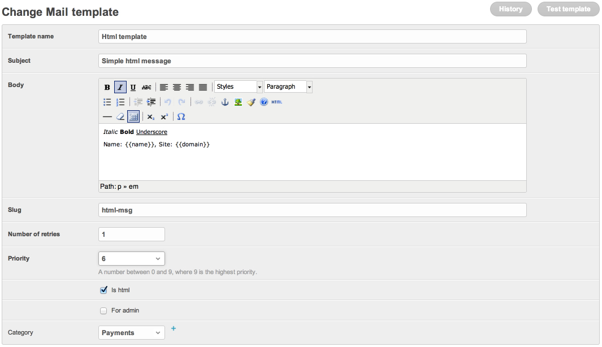

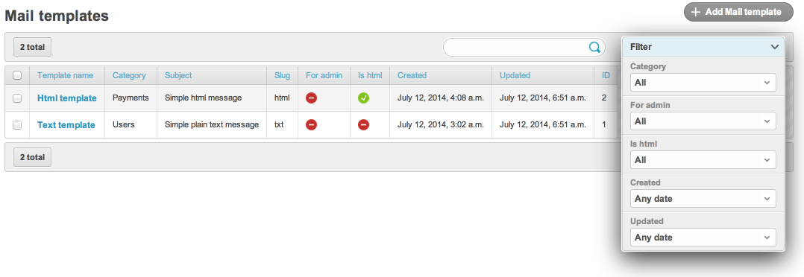

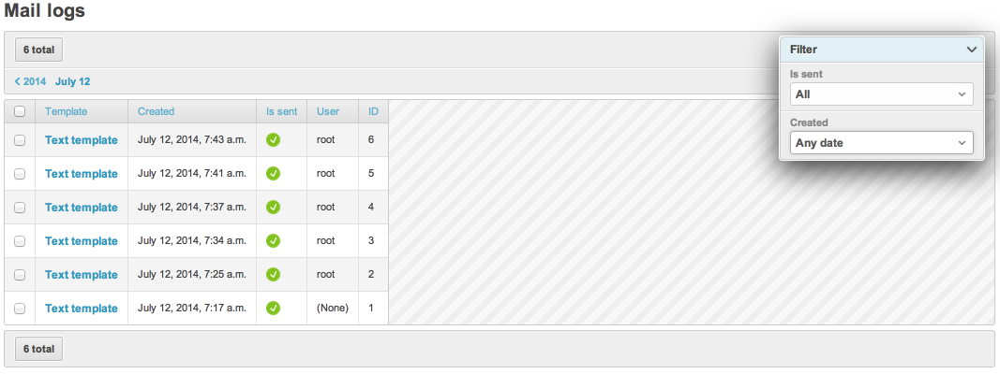

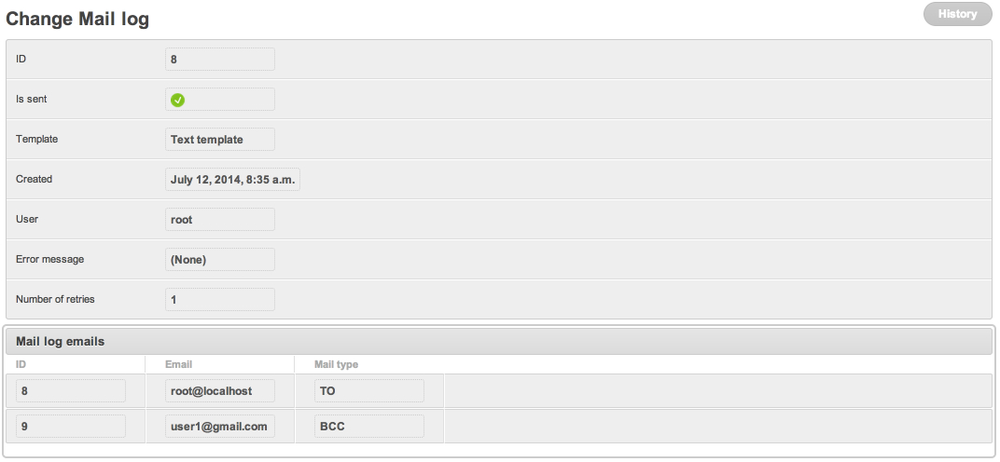

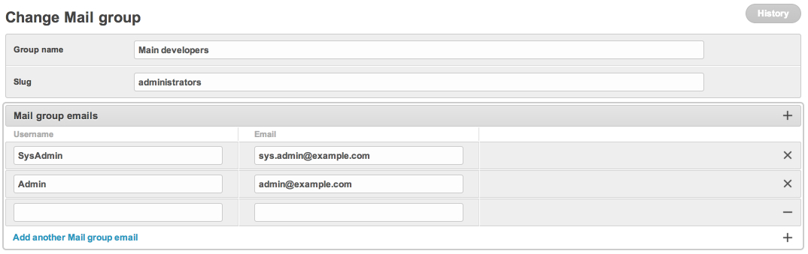

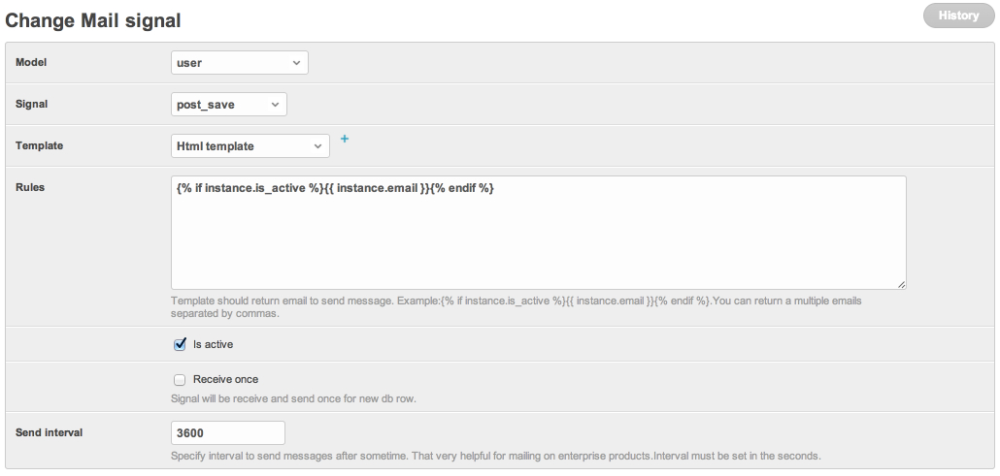

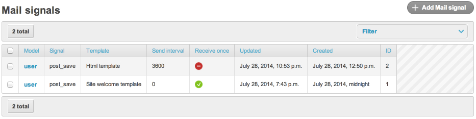

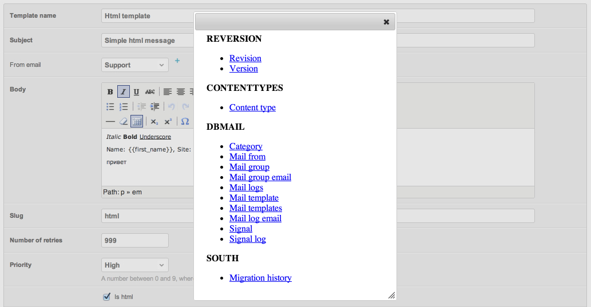

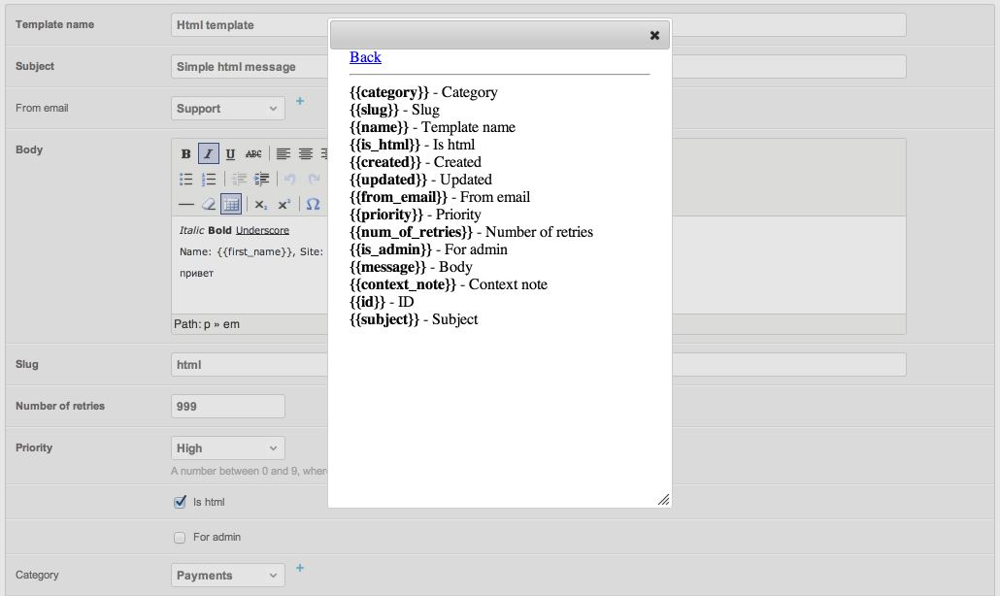

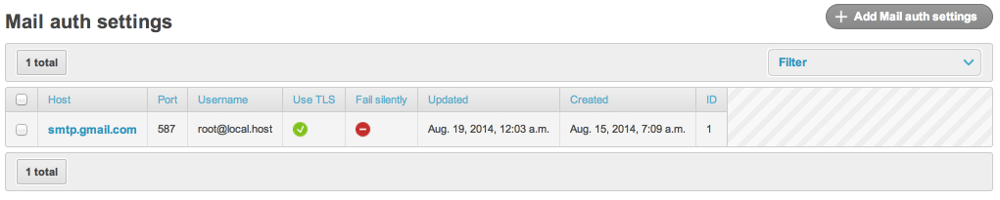

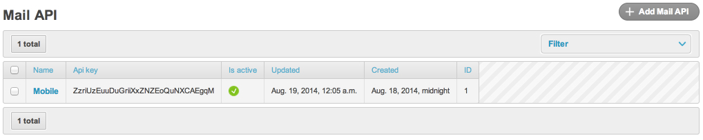

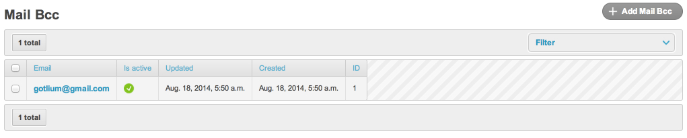

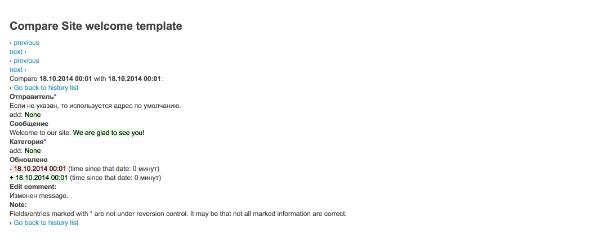

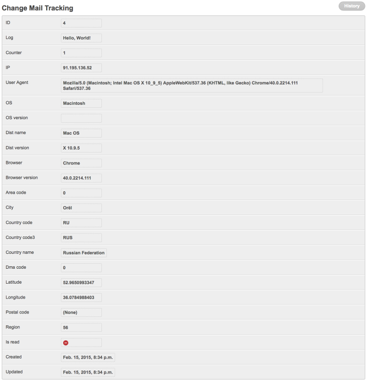

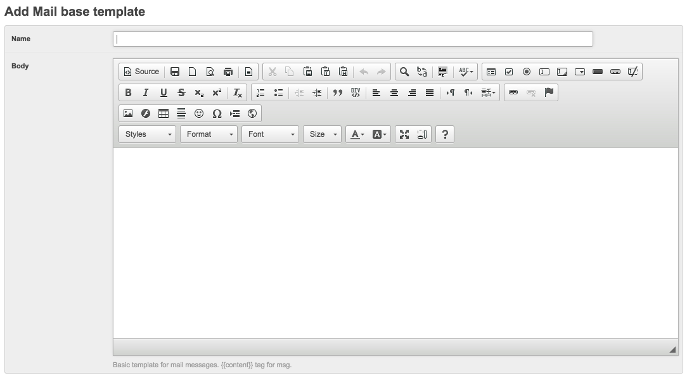

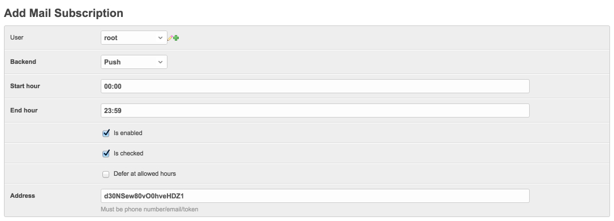

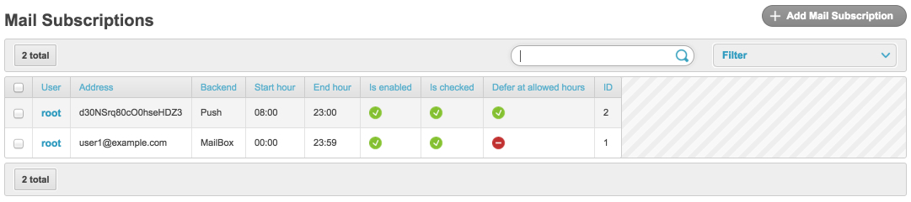

## Compatibility

- Python: 3.10, 3.11, 3.12, 3.13, 3.14
- Django: 4.2 LTS, 5.2 LTS, 6.0

For Python ≤ 3.9 / Django ≤ 4.1 use the `2.4.x` line:

```bash
pip install "django-db-mailer<3"
```

See [VERSIONS.md](VERSIONS.md) and [MIGRATION.md](MIGRATION.md).
