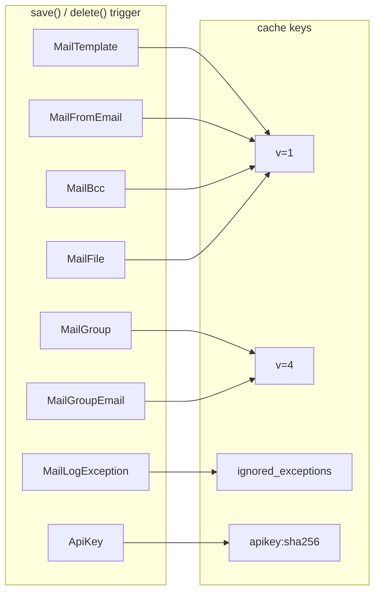

# Caching strategy

`dbmail` aggressively caches everything that hits the hot path:
`MailTemplate` lookups, `MailGroup` member lists, ignored-exceptions
set, `ApiKey` validation results, rate-limit counters. It will not
function without a working Django cache backend.

## What is cached

| Key pattern | Reader | Writer | Invalidator | TTL |
|---|---|---|---|---|
| `<MailTemplate.slug>` (version=1) | `MailTemplate.get_template` | first cache miss | `MailTemplate.save` / `MailFromEmail.save` / `MailFile.save` / `MailBcc.save` | `DB_MAILER_CACHE_TTL` (default `None` = no expiry) |
| `<MailGroup.slug>` (version=4) | `MailGroup.get_emails` | first cache miss | `MailGroup.save` / `MailGroupEmail.save` | `DB_MAILER_CACHE_TTL` |
| `MailLogException:ignored` (frozenset) | `MailLogException.get_ignored_exceptions` | first cache miss | `MailLogException.save` | `DB_MAILER_CACHE_TTL` |
| `dbmail:apikey:sha256(<raw>)` (version=1) | `views.send_by_dbmail` | after successful `is_valid_key` check | `ApiKey.save` / `ApiKey.delete` | `DB_MAILER_CACHE_TTL` |
| `dbmail:rate:sha256(<raw>)` (version=1) | `views._ratelimit_exceeded` | first request in window via `cache.add` | TTL expiry | `DB_MAILER_API_RATE_LIMIT[1]` (default 60s) |

Default `DB_MAILER_CACHE_TTL = None` means **cache entries live
forever** until invalidated. The reasoning: most of those keys are
small, the hot path reads them constantly, and explicit
event-based invalidation is more correct than time-based eviction.
The tradeoff is that a missed invalidation hook causes stale data
until a manual `MailTemplate.clean_cache()` call.

## Template cache shape

`MailTemplate.get_template(slug)` materialises the model instance
and tacks computed lists onto its `__dict__`:

```python
# dbmail/models.py:MailTemplate.get_template — schematic
obj = cache.get(slug)
if obj is not None:
    return obj
obj = (cls.objects
       .select_related("from_email", "base")
       .get(slug=slug))
obj.bcc_list = [e for e in obj.bcc_email.values_list("email", flat=True) if e]
obj.files_list = list(obj.files.all())
obj.auth_credentials = obj.from_email.get_auth() if obj.from_email else None
cache.set(slug, obj, timeout=CACHE_TTL, version=1)
return obj
```

Two known issues, both tracked for 3.1 (PERF-6):

1. **Pickled ORM instance leaks the FK graph** — `from_email`,
   `base`, `category` references chain through. The pickled blob
   for one template can hit ~10 KB. With 10 000 templates and a
   cluster-wide cache, the dbmail keyspace is non-trivial.
2. **`auth_credentials` may include SMTP password** — the cached
   blob carries plaintext credentials. Acceptable on a
   TLS-protected Redis; risky on a shared multi-tenant cache.

3.1 introduces a slim projection (only the fields the Sender reads),
mitigating both.

## Invalidation graph



Each model overrides `save()` / `delete()` to call its own
`_clean_cache()`. Bulk operations bypass the override — that's a
deliberate (and documented) limitation. If you `QuerySet.update(...)`
on `MailTemplate` directly, call `MailTemplate.clean_cache()`
afterwards.

## Lazy-QuerySet trap (the bug we fixed in 3.0)

The 2.x line cached lazy QuerySets:

```python
# 2.x — broken
emails = MailGroupEmail.objects.values_list("email", flat=True).filter(group__slug=slug)
cache.set(slug, emails, timeout=CACHE_TTL, version=4)
return emails
```

Cache backends pickle the QuerySet description, not the result rows.
On cache hit, the deserialised QuerySet is bound to the originating
DB connection — every `__contains__` / iteration re-runs the SQL.
Worse: cross-process cache hits crash on connection mismatch.

3.0 forces materialisation:

```python
# 3.0 — correct
emails = list(MailGroupEmail.objects.values_list("email", flat=True).filter(group__slug=slug))
cache.set(slug, emails, timeout=CACHE_TTL, version=4)
return emails
```

Same fix applied to `MailLogException.get_ignored_exceptions()`
(now caches a `frozenset(str)` instead of a QuerySet).

## Rate limit cache (atomic counter)

The public API endpoint uses Django's `cache.add` + `cache.incr`
primitives to build an atomic per-key window counter:

```python
# dbmail/views.py:_ratelimit_exceeded — schematic
key = "dbmail:rate:" + sha256(api_key).hexdigest()
try:
    current = cache.incr(key)
except ValueError:
    cache.add(key, 1, timeout=window)
    return False                 # first request in window
return current > count
```

`cache.add` is the atomic-create-if-absent primitive. `cache.incr`
is atomic-on-cache-backend-level (Redis: `INCR`, Memcached: `incr`).
The combination races correctly: if two requests hit `incr` and one
gets `ValueError` (key just expired), both fall back to `add`, but
only the first `add` wins (returns `True`); the second is a no-op.

Limitation: per-key counter only — an attacker rotating across N
stolen keys multiplies the effective ceiling by N. Per-IP fallback
is a 3.0.1 follow-up (see [security.md](security.md)).

## Operating notes

- **Cache backend choice** — Redis or Memcached for production.
  LocMem works only for unit tests (per-process cache, useless for
  multi-worker deployments).
- **Cache flush after upgrade** — version numbers (`version=1` for
  templates, `version=4` for groups) bump only when the cached
  shape changes. After a major upgrade run
  `python manage.py clean_dbmail_cache` to be safe.
- **Pre-warming** — `python manage.py update_dbmail_cache` walks
  every active template and warms its cache key. Useful before
  deploying a worker pool to avoid thundering-herd on first send.
- **Cache poisoning surface** — if your Redis is shared with
  untrusted tenants and the dbmail cache keys are guessable
  (`<slug>` is in the URL of admin), an attacker who can write to
  the cache backend can substitute templates. Use a per-tenant
  Redis namespace or `KEY_PREFIX` to mitigate.

## Code references

- `dbmail/models.py:MailTemplate.get_template`,
  `MailTemplate.clean_cache`, `MailTemplate._clean_cache`.
- `dbmail/models.py:MailGroup.get_emails`.
- `dbmail/models.py:MailLogException.get_ignored_exceptions`.
- `dbmail/models.py:ApiKey._cache_key`,
  `ApiKey.is_valid_key`, `ApiKey.clean_cache`.
- `dbmail/views.py:_ratelimit_exceeded`.
- `dbmail/management/commands/clean_dbmail_cache.py`,
  `update_dbmail_cache.py`.
