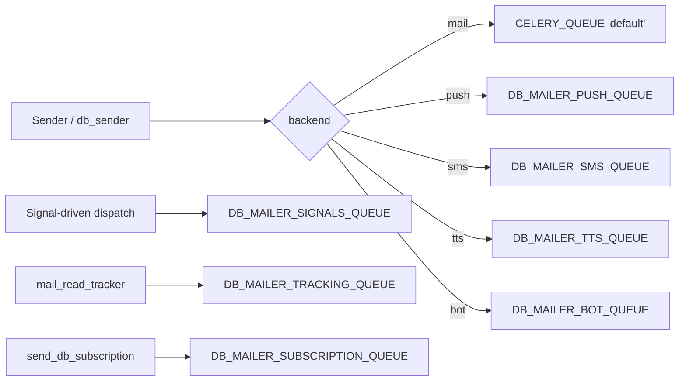

# Celery integration and dispatch

dbmail does not bundle Celery — it integrates *through* it when
available, and degrades to synchronous in-process delivery when not.
This page documents the dispatch decisions, queue routing, retry
shape, and the trap of running with the JSON serializer.

## Tasks defined in `dbmail/tasks.py`

| Task name | Bind | Retry | Default queue | Purpose |
|---|---|---|---|---|
| `dbmail.db_sender` | yes | yes | `DB_MAILER_CELERY_QUEUE` ("default") | Wraps a `Sender(...).send()` call. |
| `dbmail.signal_receiver` | no | no | `DB_MAILER_SIGNALS_QUEUE` | Runs `SignalReceiver(sender, **kwargs).run()` from a Django dispatch hook. |
| `dbmail.deferred_signal` | no | no | `DB_MAILER_SIGNALS_QUEUE` | Runs `SignalReceiver(...).run_deferred()` for `Signal.interval > 0`. |
| `dbmail.subscription` | no | no | `DB_MAILER_SUBSCRIPTION_QUEUE` | Iterates `MailSubscription` rows. |
| `dbmail.mail_track` | yes | yes | `DB_MAILER_TRACKING_QUEUE` | Persists `MailLogTrack` from the tracking pixel hit. |

`db_sender` and `mail_track` are bound (`bind=True`) so they can call
`self.retry(exc=, countdown=, max_retries=)` from inside the body —
this is how transient SMTP / vendor 5xx errors translate to Celery
retries with exponential backoff.

## Queue routing



All queue settings default to `CELERY_QUEUE` (`"default"`). For high
volume, separate the workers:

```bash
# settings.py
DB_MAILER_PUSH_QUEUE = "push_messages"
DB_MAILER_SMS_QUEUE = "sms_messages"
DB_MAILER_SIGNALS_QUEUE = "signals"

# Run dedicated workers
celery -A demo worker -Q default -n default@%h -c 4
celery -A demo worker -Q push_messages -n push@%h -c 8
celery -A demo worker -Q sms_messages -n sms@%h -c 2
celery -A demo worker -Q signals -n signals@%h -c 2
```

## ETA, countdown, priority

`db_sender` reads `MailTemplate.priority` and `send_after` (caller
kwarg) and wires them into `apply_async`:

```python
# dbmail/__init__.py:db_sender — schematic
options = {"queue": kwargs.get("queue") or queue_for_backend, ...}
if "send_after" in kwargs:
    options["countdown"] = kwargs.pop("send_after")
if "send_at_date" in kwargs:
    options["eta"] = kwargs.pop("send_at_date")
options["priority"] = template.priority   # 0..9 from PRIORITY_STEPS
options["time_limit"] = kwargs.get("time_limit", SEND_MAX_TIME)
return tasks.db_sender.apply_async(args=(slug, recipient, *args), kwargs=kwargs, **options)
```

Notes:

- `priority` works only on the **Redis** broker (Celery 5.4 caveat
  — RabbitMQ priority queues need `x-max-priority` queue arg
  configured separately).
- `countdown` and `eta` are mutually exclusive — pass at most one.
- `time_limit` defaults to `DB_MAILER_SEND_MAX_TIME = 30` seconds.

## Retry shape

`tasks.db_sender` wraps the actual send in a try/except:

```python
# dbmail/tasks.py:db_sender — schematic
@shared_task(bind=True, name="dbmail.db_sender",
             default_retry_delay=SEND_RETRY_DELAY)
def db_sender(self, *args, **kwargs):
    retry_delay = kwargs.pop("retry_delay", SEND_RETRY_DELAY)
    max_retries = kwargs.pop("max_retries", SEND_RETRY)
    backend = import_module(kwargs.get("backend"))
    retry = kwargs.pop("retry", True)
    try:
        return backend.Sender(*args, **kwargs).send(is_celery=True)
    except Exception as exc:
        if retry and max_retries:
            raise self.retry(exc=exc, countdown=retry_delay, max_retries=max_retries) from exc
        raise
```

- Defaults: `SEND_RETRY=3`, `SEND_RETRY_DELAY=300` (5 min).
- Per-call override: `send_db_mail("welcome", "u@e.com", retry_delay=60, max_retries=5)`.
- Permanent errors (`TemplateDoesNotExist`, `ValueError`) currently
  also retry — classifying them as fatal is a 3.1 follow-up.

## Result backend and pickle warning

dbmail tasks return `"OK"` strings or `None` — **never** complex
Python objects. Use `CELERY_TASK_SERIALIZER = "json"` and
`CELERY_RESULT_SERIALIZER = "json"`. The legacy default
`"pickle"` is a CWE-502 risk if your result backend is shared with
untrusted writers; the dbmail code does not rely on pickle results.

If you set `CELERY_TASK_ALWAYS_EAGER = True` (test mode), enable
`CELERY_TASK_EAGER_PROPAGATES = True` so exceptions surface to the
caller instead of being swallowed by Celery's eager fake.

## The "User instance is not JSON serializable" trap

A historical bug: passing `user=request.user` through `send_db_mail`
queued the whole Django User instance via `apply_async(args=...)`,
which the JSON serializer rejected with `EncodeError`. 3.0 mitigates
two ways:

- The admin "Send test mail" view explicitly does **not** pass
  `request.user` directly (pass `user.pk` or omit).
- The Sender's `kwargs.pop("user", None)` accepts a User instance
  *only* in the synchronous path; the Celery dispatch path expects
  a primary key or `None`.

If you write your own helper:

```python
# Good
send_db_mail("welcome", recipient.email, {"username": recipient.username})

# Bad — User instance leaks into the JSON payload
send_db_mail("welcome", recipient.email, user=recipient)

# Compromise — pass the primary key
send_db_mail("welcome", recipient.email, user=recipient.pk)
```

## Eager mode for tests

```python
# tests.settings or pytest fixture
CELERY_TASK_ALWAYS_EAGER = True
CELERY_TASK_EAGER_PROPAGATES = True
CELERY_BROKER_URL = "memory://"
```

Eager runs every `.apply_async` inline — useful in pytest to assert
on `mail.outbox` after `send_db_mail`. The dbmail test suite does
exactly this; see `tests/conftest.py`.

## Worker prefetch tuning

For SMTP-heavy workloads set:

```python
CELERY_WORKER_PREFETCH_MULTIPLIER = 1
CELERY_TASK_ACKS_LATE = True
```

Prefetch=1 prevents head-of-line blocking — a slow STARTTLS
handshake on one worker does not pin three other tasks waiting in
its prefetch buffer.

`acks_late=True` means the broker keeps the task message until the
worker reports success. Combined with `task_reject_on_worker_lost`,
it survives worker crashes mid-send (the task gets re-delivered to
another worker).

## Graceful shutdown

dbmail does not own worker lifecycle — Celery's `--time-limit` /
`--soft-time-limit` and SIGTERM handling apply. Recommended
production config:

```bash
celery -A demo worker \
    --time-limit=60 \
    --soft-time-limit=50 \
    --max-tasks-per-child=1000 \
    -Q default,push_messages,sms_messages
```

`--max-tasks-per-child` recycles the worker process every N tasks
to bound memory growth — useful when caching `MailTemplate`
instances inflates the per-process heap.

## Beat schedule (deferred signal cron)

The `send_dbmail_deferred_signal` management command must run on a
schedule. If you use Celery Beat:

```python
# settings.py
CELERY_BEAT_SCHEDULE = {
    "dbmail-deferred-signal": {
        "task": "myapp.tasks.deferred_drainer",
        "schedule": 60.0,
    },
}
```

Where `myapp.tasks.deferred_drainer` is a thin wrapper:

```python
@shared_task(name="myapp.deferred_drainer")
def deferred_drainer():
    from django.core.management import call_command
    call_command("send_dbmail_deferred_signal", limit=500)
```

dbmail does not register a Beat task itself — left to the operator
because Beat schedule is project-wide.

## Code references

- `dbmail/__init__.py:db_sender` — dispatcher (sync vs Celery).
- `dbmail/tasks.py` — five Celery tasks.
- `dbmail/management/commands/send_dbmail_deferred_signal.py` — cron
  drainer with `select_for_update(skip_locked=True)`.
- `dbmail/defaults.py` — `*_QUEUE` settings, `SEND_*` retry knobs.
