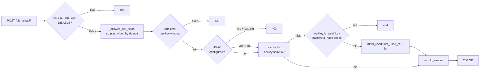

# Security model

This page documents how each security control is implemented, where
it sits in the request flow, and what the residual risks look like.
For responsible-disclosure instructions, open a GitHub Security
Advisory via the repository's **Security** tab.

## Threat model

```mermaid
flowchart LR
    subgraph "External"
        attacker[Attacker / curious 3rd party]
        recipient[Recipient mailbox]
    end

    subgraph "Trust boundary"
        api[/dbmail/api/<br/>send_by_dbmail]
        admin[Django admin]
        worker[Celery worker]
        db[(DB)]
        cache[(Cache)]
        sites[Outbound providers<br/>SMTP / Twilio / FCM / ...]
    end

    attacker -->|stolen ApiKey| api
    attacker -->|XSS / CSRF / brute force| admin
    attacker -->|SQLi in sibling app| db
    api --> worker
    admin --> db
    worker --> sites
    sites --> recipient
    db --> worker
    cache --> worker
```

In-scope:

- Post-auth RCE / privilege escalation between staff users.
- SSRF, header injection, credential leak.
- Deserialization of untrusted data (pickle path).
- DoS via unbounded payloads / unbounded retries.
- Exfiltration via SSTI in admin-editable templates.

Out of scope (Django itself / operator's responsibility):

- XSS / CSRF inside Django admin.
- TLS termination of the public endpoint.
- Plaintext-at-rest of operator-supplied SMTP passwords (a
  documented residual — encrypted column in 3.1).
- Backup / restore of `MailFromEmailCredential` table.

## API endpoint defense-in-depth (`/dbmail/api/`)



Layers, in request order:

1. **Kill switch** (`DB_MAILER_API_DISABLE`) — operator-side toggle.
   Returns 403 before touching DB. Used during incident response.
2. **Field whitelist** (`_allowed_api_fields()`) — `provider` POST
   field is **stripped by default**. Re-enable via
   `DB_MAILER_API_ALLOW_PROVIDER_OVERRIDE = True` + exhaustive
   `DB_MAILER_API_PROVIDER_ALLOWLIST` tuple. Closes the original
   SEC-1 RCE (CWE-94 / CWE-470).
3. **Rate limit** (`_ratelimit_exceeded`) — atomic per-key counter
   via `cache.add` + `cache.incr`. Default `(60, 60)` — 60 requests
   per 60 seconds.
4. **HMAC** (`_hmac_check`) — optional body signature, enforced via
   `hmac.compare_digest` when `DB_MAILER_API_HMAC_SECRET` is set.
   The body is read once via `request.body` *before* any
   `request.POST` access so the stream is not consumed.
5. **Credential cache lookup** — `dbmail:apikey:sha256(raw)`. On
   hit, skip the expensive Argon2/PBKDF2 hash check.
6. **Hash validation** — Django's `check_password()` against
   `ApiKey.password_hash`. Argon2 if installed (preferred), else
   PBKDF2-SHA256.
7. **`mark_used`** — populates `last_used_at` and `last_used_ip`
   (resolved via `django-ipware`).

## Admin SSTI surface

`MailTemplate.subject`, `MailTemplate.message`,
`MailBaseTemplate.message`, and `Signal.rules` are rendered through
the standard Django template engine against the model instance. A
non-superuser staff member with `change_mailtemplate` could
otherwise paste:

```jinja
{{ instance.__class__.__init__.__globals__.django.conf.settings.SECRET_KEY }}
```

…and trigger a send to read the secret.

3.0 mitigates by gating the four fields:

- `MailTemplateAdmin.has_add_permission` — superuser only.
- `MailTemplateAdmin.get_readonly_fields` — `subject`, `message`,
  `from_email` are read-only for non-superusers.
- `MailBaseTemplateAdmin` — same pattern.
- `SignalAdmin.has_change_permission` — superuser only on existing
  rows.

As an additional defense-in-depth option, 3.0 ships an opt-in sandboxed
renderer via `DB_MAILER_USE_JINJA2_SANDBOX = True`. When enabled,
templates are rendered through `jinja2.sandbox.SandboxedEnvironment`,
which statically blocks `__class__.__init__.__globals__` and similar
gadget chains at the Jinja2 AST level — without requiring the
superuser-only field gate to hold. Trade-off: Django-specific tags
(``, ``, ``) are unavailable in sandboxed
mode. Requires `pip install django-db-mailer[sandbox]`.

The superuser-only gate remains the primary control. The sandbox is a
secondary layer for deployments that allow a broader set of staff
editors.

Until you enable the sandbox **do not delegate
`dbmail.change_mailtemplate` to untrusted staff**.

## Pickle deserialization gate

`SignalDeferredDispatch._load_field` is the only `pickle.loads()`
call site in 3.0. It is gated:

```python
if json_value is not None:
    return json_value
if not getattr(settings, "DB_MAILER_ALLOW_PICKLE_LEGACY", False):
    raise RuntimeError(...)
return pickle.loads(pickle_blob)   # legacy data only, removed in 4.0
```

The default `DB_MAILER_ALLOW_PICKLE_LEGACY = False` makes the call
site cold. Operators upgrading from 2.x must opt in explicitly during
the migration window — and turn it off again afterwards. See
[signal_pipeline.md](signal_pipeline.md) for the dual-write rationale
and the three-step removal plan.

**Threat surface when the flag is on:** any actor who can write to
the `dbmail_signaldeferreddispatch` row (SQL injection in a sibling
app, leaked DBA credential, malicious Django admin user with
`change_signaldeferreddispatch`) gets RCE on the next cron tick. Do
not flip the flag in environments with that exposure.

## API endpoint audit log

Every hit on `/dbmail/api/` writes a row to `ApiKeyUsageAudit`,
regardless of whether the request succeeds or fails. The `action`
field records what happened:

| Action | Meaning |
|---|---|
| `kill_switch` | Endpoint disabled via `DB_MAILER_API_DISABLE`. |
| `missing_api_key` | No key in POST body or `Authorization` header. |
| `provider_blocked` | `provider` field present but not in allowlist. |
| `rate_limit` | Per-key rate window exceeded. |
| `hmac_invalid` | HMAC signature check failed. |
| `invalid_key` | Key not found or hash mismatch. |
| `bad_request` | Missing `slug` or `recipient`. |
| `send` | Dispatch initiated (success=True). |

This table is a forensics surface for incident response and abuse
detection (brute-force key enumeration, unusual slug usage). It does
not participate in request processing — a write failure is logged
and swallowed, it never blocks a legitimate send.

Retention and cleanup are the operator's responsibility. There is no
automatic purge; add a periodic task or a DB-level partition strategy
if the table grows large.

## Signal dispatch idempotency

`SignalLog` records each `(model_class, model_pk, signal)` triple
that has been dispatched for signals with `receive_once = True`.
In 3.0 the table gains a `UniqueConstraint` on those three columns.
`Signal.mark_as_sent` now issues `get_or_create` against that
constraint, making the call idempotent under Celery worker races.

The practical effect: if two workers pick up the same signal event
simultaneously (e.g. a Celery task retry on a transient broker
timeout), only one send reaches the provider. The second worker's
`get_or_create` returns the existing row and does not dispatch again.

## SSRF guard (`http/push.py`)

The `dbmail.providers.http.push` provider lets an operator point at
an arbitrary HTTPS endpoint. Without a guard, an attacker who could
edit the operator's settings file (or push a malicious template
referencing the recipient field as a URL) would have an SSRF
primitive into the cluster's internal network.

`_resolve_or_raise` validates the URL:

- Scheme must be `http` or `https` (no `file://`, `gopher://`).
- Resolved IP must not be RFC1918 / link-local / loopback / CGNAT /
  ULA.
- Host must match the operator's `DBMAIL_HTTP_ALLOWED_HOSTS`
  allowlist.

Residual: DNS-rebinding TOCTOU window between resolve and connect
(`http.client.HTTPSConnection` re-resolves on `connect()`). The
pinned IP is computed but not used. A 3.0.1 fix wires the pinned IP
into `HTTPSConnection(pinned_ip, server_hostname=original_host)`.

## Path traversal guard (Safari pushPackages)

`SafariPushPackagesView` serves `<DB_MAILER_SAFARI_PUSH_PATH>/<site_pid>.zip`
to authenticated Safari subscribers. Without a guard, `site_pid="../etc/passwd"`
would escape the directory. `_safe_safari_push_path`:

```python
def _safe_safari_push_path(site_pid: str) -> str | None:
    base = os.path.realpath(defaults.SAFARI_PUSH_PATH)
    candidate = os.path.realpath(os.path.join(base, f"{site_pid}.zip"))
    if not candidate.startswith(base + os.sep):
        return None
    return candidate
```

The combination of `realpath` (resolves symlinks) and
`startswith(base + os.sep)` (anchors below base, not equal to base)
defeats `..` traversal, absolute-path injection, and symlink-chain
escapes. Tests in `tests/test_admin_integration.py` and
`tests/test_views.py` exercise the boundary.

## Credential storage

| Asset | Storage | Status |
|---|---|---|
| `ApiKey.api_key` (raw) | plain CharField(32), unique | **kept until 4.0** for the 3.x compat window — admin masks display, no plain-text leak in serialised form. |
| `ApiKey.password_hash` | Argon2 / PBKDF2 via `make_password()` | canonical credential since 3.0. |
| `MailFromEmailCredential.password` | plain CharField(128) | **plaintext at rest** — admin restricted to superusers, password widget on form, encrypted column in 3.1. |
| `DB_MAILER_API_HMAC_SECRET` | `settings.py` (env var recommended) | operator's responsibility. |
| `Site.objects.get_current()` data | DB, plain | not sensitive. |

## Logging hygiene

- `dbmail.audit` logger emits structured events for ApiKey rotate /
  revoke / send-by-dbmail success / send-by-dbmail rejection.
- Sensitive fields (`api_key`, `password`, `password_hash`,
  `auth_credentials`) are **not** logged anywhere in dbmail's own
  code.
- `traceback.format_exc()` is captured into `MailLog.error_message`.
  In `DEBUG=False` mode, locals are not serialised; only file paths
  and stack frames. This is a low-severity residual — operators
  with `view_maillog` see the trace.

## Defaults that already protect you

- `provider` POST field rejected.
- `DEBUG` not exposed via dbmail views.
- Hashed credentials.
- Atomic per-key rate limit.
- HMAC available (off by default — set the secret to opt in).
- SSRF allowlist.
- Path-traversal guard.
- Pickle gate off (`DB_MAILER_ALLOW_PICKLE_LEGACY = False`).
- `DB_MAILER_API_DISABLE` kill-switch off.
- All providers with `timeout=10` + try/finally close.
- Full API audit trail in `ApiKeyUsageAudit`.
- Signal dispatch idempotency via `SignalLog` unique constraint.
- Jinja2 sandbox available (`DB_MAILER_USE_JINJA2_SANDBOX`, off by default).

## Residual risks

| Risk | Severity | Target |
|---|---|---|
| `MailFromEmailCredential.password` plaintext at rest | medium | 3.1 — `EncryptedCharField` |
| `ApiKey.api_key` legacy plain column | low | 4.0 removal |
| Pickle path opt-in | low (off by default) | 4.0 column drop |
| EOL providers (`parse_com`, `boxcar`, `prowl`, legacy `apns`, legacy GCM) | low | 4.0 module removal |
| DNS-rebind TOCTOU in `http/push.py` | low | 3.0.1 |
| No per-IP rate limit fallback | low | 3.0.1 |
| No JSON body size cap on `/dbmail/api/` | low | 3.0.1 |
| `MailLogTrack` PII retention | low | document `clean_dbmail_logs` cron in operator runbook |

## Code references

- `dbmail/views.py:send_by_dbmail` — the public endpoint.
- `dbmail/admin.py:MailTemplateAdmin`,
  `MailBaseTemplateAdmin`, `SignalAdmin` — SSTI gates.
- `dbmail/models.py:ApiKey.save`, `is_valid_key`, `mark_used` —
  credential lifecycle.
- `dbmail/models.py:SignalDeferredDispatch._load_field` — pickle gate.
- `dbmail/providers/http/push.py` — SSRF guard.
- `dbmail/views.py:_safe_safari_push_path` — path-traversal guard.
- `tests/test_security_sec1_sec2.py` — regression tests for SEC-1
  and SEC-2.
