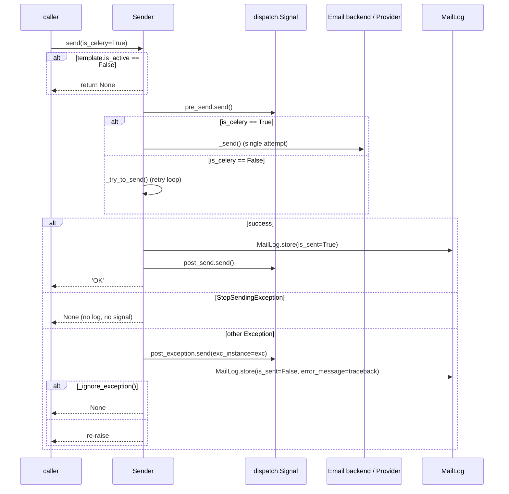

# Sender lifecycle (single message)

The `Sender` class in `dbmail/backends/mail.py` is the heart of the
delivery pipeline. The four other channels (`sms`, `tts`, `push`,
`bot`) subclass it and override the recipient parser and send hook;
the lifecycle below describes mail and applies to every channel.

## `Sender.__init__`

```python
# dbmail/backends/mail.py:32-58
def __init__(self, slug, recipient, *args, **kwargs):
    self._slug = slug
    self._recipient_list = self._get_recipient_list(recipient)
    self._cc = self._email_to_list(kwargs.pop("cc", None))
    self._bcc = self._email_to_list(kwargs.pop("bcc", None))
    self._user = kwargs.pop("user", None)
    self._language = kwargs.pop("language", None)
    self._backend = kwargs.pop("backend")
    self._provider = kwargs.pop("provider", self.provider)
    self._signals_kw = kwargs.pop("signals_kwargs", {})

    self._template = self._get_template()         # cache → DB
    self._context = self._get_context(args)       # context dict + Site

    self._subject = self._get_subject()           # Template().render
    self._message = self._get_message()           # Template().render
    self._files = kwargs.pop("files", [])
    self._kwargs = kwargs
    self._num = 1
    self._err_msg = None
    self._err_exc = None
    self._log_id = self._get_log_id()             # uuid for tracking pixel

    self._kwargs.pop("retry", None)               # consumed by Celery layer
    self._kwargs.pop("max_retries", None)
    self._kwargs.pop("retry_delay", None)

    self._from_email = self._get_from_email()
    self._update_bcc_from_template_settings()
    self._insert_mailer_identification_head()
```

Step order matters:

1. **Recipient resolution first** — `_get_recipient_list` accepts a
   string (single address or comma-separated), a list, or a
   `MailGroup.slug`. Throws on `None` / non-string non-list.
2. **Template fetch second** — `MailTemplate.get_template(slug)` hits
   cache; cache miss does one ORM query with `select_related("from_email", "base")`.
3. **Context third** — pulled from `*args` plus `Site.objects.get_current()`
   automatically.
4. **Render subject + message** — `Template(...).render(Context(...))`
   inside `translation.override(self._language)` so ``
   resolves correctly without leaking the locale.
5. **Reserve `_log_id`** — UUID-shaped, used both as `MailLog.log_id`
   and as the encrypted token in the tracking pixel URL.

## `send(is_celery=True)` — the public verb



The two branches:

- **Celery** (default) — `_send` is called exactly once. Retries are
  the Celery task's responsibility (`tasks.db_sender` re-raises via
  `self.retry(exc=, countdown=, max_retries=)`).
- **Sync** — `_try_to_send` loops `MailTemplate.num_of_retries` times
  with `time.sleep(SEND_RETRY_DELAY_DIRECT)` between attempts.

`StopSendingException` is the application-controlled bail-out — your
custom backend can raise it from a `pre_send` handler to abort
without logging an error.

## `_send`: native vs custom provider

```mermaid
flowchart LR
    send[_send]
    send --> has_provider{self._provider<br/>set?}
    has_provider -->|yes| custom[_send_by_custom_provider:<br/>importlib.import_module(provider).send(self)]
    has_provider -->|no| native[_send_by_native_provider]
    native --> is_html{template.is_html?}
    is_html -->|yes| html[_send_html_message:<br/>EmailMultiAlternatives + tracking pixel]
    is_html -->|no| plain[_send_plain_message:<br/>EmailMessage]
```

For non-mail backends (`sms`, `push`, `tts`, `bot`) `_send` always
takes the custom-provider branch — there is no "native" equivalent
of an SMTP server for those channels.

> **Security gate** — `self._provider` reaches `import_module()`. The
> public API endpoint strips the `provider` POST field by default
> (SEC-1 in [security.md](security.md)). Direct Python callers
> control the value themselves.

## Tracking pixel injection

When `template.is_html=True` AND `DB_MAILER_TRACK_ENABLE=True` AND
`DB_MAILER_ENABLE_LOGGING=True`:

```python
# dbmail/backends/mail.py — schematic
def _get_msg_with_track(self):
    encrypted = signing.dumps(self._log_id)
    site = Site.objects.get_current()
    url = "//" + site.domain + reverse("dbmail:db-mail-tracker", args=[encrypted])
    pixel_html = TRACK_HTML % {"url": url}
    return self._message + pixel_html
```

The pixel URL only encrypts the `_log_id` — recipient address is not
in the URL. When the recipient's mail client requests the URL,
`mail_read_tracker` view writes / increments a `MailLogTrack` row.

See [security.md](security.md) for the path-traversal guard on the
Safari pushPackage variant.

## Error handling and the `MailLogException` ignore-list

`Sender._ignore_exception` checks the exception class name against
`MailLogException` rows where `ignore=True`. The set is cached as a
`frozenset` to avoid the lazy-QuerySet trap (`MailLogException.get_ignored_exceptions`).

```python
# dbmail/backends/mail.py — schematic
try:
    self._send()
except StopSendingException:
    return                              # silent abort
except Exception as exc:
    self._err_exc = exc.__class__.__name__
    if self._ignore_exception():
        return                          # logged but not re-raised
    raise                               # Celery retries, sync caller sees it
```

Real-world example: `SMTPRecipientsRefused` from a recipient with a
typo in their address. Toggling `ignore=True` on that exception class
stops Celery from retrying every minute for the next hour.

## Specialized backends

Each non-mail backend overrides only what differs:

| Backend | Override |
|---|---|
| `sms.py:Sender` | `_get_recipient_list` (phone numbers), `_send` (custom provider) |
| `tts.py` | re-exports `sms.Sender` and `sms.SenderDebug` (TTS shares the SMS contract) |
| `push.py:Sender` | `_get_recipient_list` (device tokens), `_send` (custom provider) |
| `bot.py:Sender` | `_get_recipient_list` (chat ids), `_send` (custom provider) |

The shared base class behaviour (template fetch, render, MailLog,
signals) is unchanged.

## What does **not** happen during `send()`

- **No DB transaction wraps the send.** SMTP / HTTP calls inside
  `transaction.atomic` are explicitly forbidden — see
  `CLAUDE.md` and [security.md](security.md).
- **No retry budget consultation.** The retry policy lives on the
  template (`num_of_retries`) for the sync path or on the Celery
  task wrapper for the async path.
- **No bulk batching.** One `Sender.send()` per `db_sender` call. For
  fan-out, instantiate a `MailGroup` and pass `recipient="group-slug"`
  — every member gets its own `Sender`. PERF-1 (batch via
  `bulk_create` for `MailLogEmail`) lands in 3.0.1.

## Code references

- `dbmail/backends/mail.py` — full `Sender` class.
- `dbmail/backends/{sms,tts,push,bot}.py` — channel overrides.
- `dbmail/__init__.py:60-102` — `db_sender` dispatcher.
- `dbmail/tasks.py:db_sender` — Celery task wrapper with retry.
- `dbmail/models.py:MailTemplate.get_template` — cache + ORM read.
- `dbmail/models.py:MailLog.store` — log persistence.
