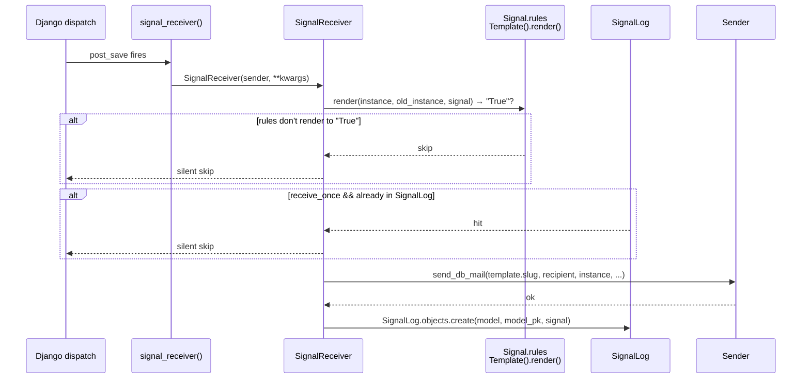

# Signal pipeline (DB-driven)

dbmail wires Django's built-in `dispatch` framework (`pre_save`,
`post_save`, `pre_delete`, `post_delete`, `m2m_changed`) to
`MailTemplate` rows through `Signal` records — no Python signal
handlers in your codebase.

## Two kinds of signals — do not confuse them

`dbmail` uses the word "signal" in two distinct meanings:

| Term | What it is |
|---|---|
| `Signal` model row in DB | configuration: "fire MailTemplate X when ContentType Y receives signal Z" |
| `dispatch.Signal` instance from `django.dispatch` | the underlying Django signal slot that the row binds to |

`dbmail` also exports its own ten `dispatch.Signal` instances
(`pre_send`, `post_send`, `post_exception`, `safari_subscribe`,
`safari_unsubscribe`, `safari_error_log`, `safari_push_package`,
`push_subscribe`, `push_unsubscribe`) — those are observers of
delivery events, unrelated to the DB-driven `Signal` model.

## Wire-up at startup

```mermaid
flowchart LR
    boot[App ready] --> initial[initial_signals]
    initial --> active{Signal.objects.filter<br/>is_active=True}
    active --> connect[def_signal.connect<br/>signal_receiver,<br/>sender=ContentType,<br/>dispatch_uid='dbmail-signal-{pk}']
```

`dbmail/apps.py:DbMailConfig.ready()` calls `initial_signals()`. For
every active `Signal` row, it grabs the matching dispatch slot
(`django.db.models.signals.post_save` etc.) and connects
`signal_receiver` as the listener. The `dispatch_uid` is unique per
row PK — `f"dbmail-signal-{signal.pk}"` — preventing the silent
overwrite bug that earlier versions had when two Signal rows pointed
at the same model with different signal kinds.

To re-wire after editing Signal rows in admin (e.g. flipping
`is_active`), call `initial_signals()` again. WSGI / uWSGI auto-reload
hooks (`MailTemplateAdmin.save_model`) trigger this for free in dev;
production needs an explicit worker restart.

## `SignalReceiver.run` flow



The flow above describes immediate dispatch. For non-zero
`Signal.interval` the runner takes the deferred path instead.

## Deferred dispatch (interval > 0)

```mermaid
flowchart LR
    fire[signal_receiver fires]
    fire --> interval{Signal.interval > 0?}
    interval -->|no| send[Sender.send immediately]
    interval -->|yes| persist[SignalDeferredDispatch.objects.create<br/>eta = now + interval]
    persist --> wait[(rows wait in DB)]
    cron[send_dbmail_deferred_signal cron] --> claim[SELECT ... WHERE done IS NULL<br/>AND eta <= now()<br/>FOR UPDATE SKIP LOCKED]
    claim --> dispatch[run_task → Celery deferred_signal task]
    dispatch --> done{purge?}
    done -->|DB_MAILER_SIGNAL_DB_DEFERRED_PURGE=True| delete[delete row]
    done -->|False| mark[mark done=True for audit]
```

Two configuration knobs:

- `DB_MAILER_SIGNAL_DEFERRED_DISPATCHER` — `"celery"` (default) puts
  the work on `apply_async(eta=...)`; `"db"` writes a
  `SignalDeferredDispatch` row drained by the management command
  cron.
- `DB_MAILER_SIGNAL_DB_DEFERRED_PURGE` — if `True`, dispatched rows
  are deleted; if `False`, kept with `done=True` for audit.

`SELECT FOR UPDATE SKIP LOCKED` (PostgreSQL ≥ 9.5, MySQL ≥ 8) makes
the cron safe to run in parallel — two workers will not double-fire
the same row. SQLite ignores `SKIP LOCKED` and falls back to lock
contention; acceptable for development, not production.

## Pickle to JSON dual-write

Legacy `SignalDeferredDispatch.args / kwargs / params` columns were
`TextField` storing pickle blobs in the 2.x line. 3.0 adds three
sister `JSONField` columns (`args_json` etc.) and dual-writes:

| Step | Release | What |
|---|---|---|
| Step 1 | 3.0 | New rows write **both** pickle (`BinaryField` now,
                  not `TextField`) and JSON if the payload is JSON-encodable. Reads prefer JSON; pickle is the fallback gated by `DB_MAILER_ALLOW_PICKLE_LEGACY`. |
| Step 2 | 3.1 | `dbmail_migrate_pickle` management command rewrites
                  legacy rows to JSON-only. New rows are JSON-only. |
| Step 3 | 4.0 | Pickle columns dropped from the schema. The
                  `DB_MAILER_ALLOW_PICKLE_LEGACY` toggle removed. |

The pickle path is tightly gated:

```python
# dbmail/models.py:SignalDeferredDispatch._load_field — schematic
if json_value is not None:
    return json_value
if not getattr(settings, "DB_MAILER_ALLOW_PICKLE_LEGACY", False):
    raise RuntimeError(
        f"row pk={self.pk} has only legacy pickle payload. "
        "Set DB_MAILER_ALLOW_PICKLE_LEGACY=True or rewrite to JSON."
    )
return pickle.loads(pickle_blob)   # legacy data only, removed in 4.0
```

The default `DB_MAILER_ALLOW_PICKLE_LEGACY = False` makes a pickle
read raise `RuntimeError`, which is caught and logged by the cron
without crashing it. Operators upgrading from 2.x must opt in
explicitly during the migration window — see
[security.md](security.md) for the threat-model implication
(deserialization of attacker-injected DB rows).

## `Signal.rules` is a Django template — be careful

`Signal.rules` is rendered through `django.template.Template` against
the model instance (`True`).
This is convenient and dangerous:

- **Convenient** — non-coders can write filter logic in admin.
- **Dangerous** — same SSTI surface as `MailTemplate.message`
  (CWE-1336). A staff user with `change_signal` could otherwise
  write `{{ instance.__class__.__init__.__globals__... }}` and
  read settings.

3.0 mitigates by restricting Signal admin to superusers
(`SignalAdmin.has_change_permission`). 3.1 will swap the renderer
to a sandboxed Jinja2 environment. Until then: do not delegate
`change_signal` to untrusted staff.

## Signal kinds supported

The `Signal.signal` field is a CharField with choices populated from
`django.db.models.signals` at app load:

- `pre_save` — fires before `save()` writes; `instance` reflects the
  caller's intent (not yet persisted).
- `post_save` — fires after `save()`; `instance` reflects the persisted
  state. Most common choice.
- `pre_delete` — fires before `delete()` removes the row.
- `post_delete` — fires after the row is gone; `instance.pk` is None.
- `m2m_changed` — fires on M2M relation changes; `kwargs` includes
  `action`, `pk_set`.

Custom dispatch.Signal instances from third-party apps (e.g.
allauth's `user_signed_up`) are **not** wired through the DB-driven
flow. Connect those by hand in your `apps.py:ready()` and call
`send_db_mail` directly.

## `update_model` flag

If `Signal.update_model=True`, the runner stamps `mail_sent` (or any
field name returned by `get_update_field()`) on the instance after
a successful send. Use this to query "users who already received
welcome" without a separate `SignalLog` join.

## Code references

- `dbmail/signals.py` — `signal_receiver`, `SignalReceiver`,
  `initial_signals`, the ten `dispatch.Signal` instances.
- `dbmail/models.py:Signal` — model + `Meta.choices`.
- `dbmail/models.py:SignalDeferredDispatch` — deferred queue.
- `dbmail/models.py:SignalLog` — receive-once tracking.
- `dbmail/management/commands/send_dbmail_deferred_signal.py` — cron.
- `dbmail/tasks.py:signal_receiver`, `tasks.deferred_signal` — Celery
  task variants.
