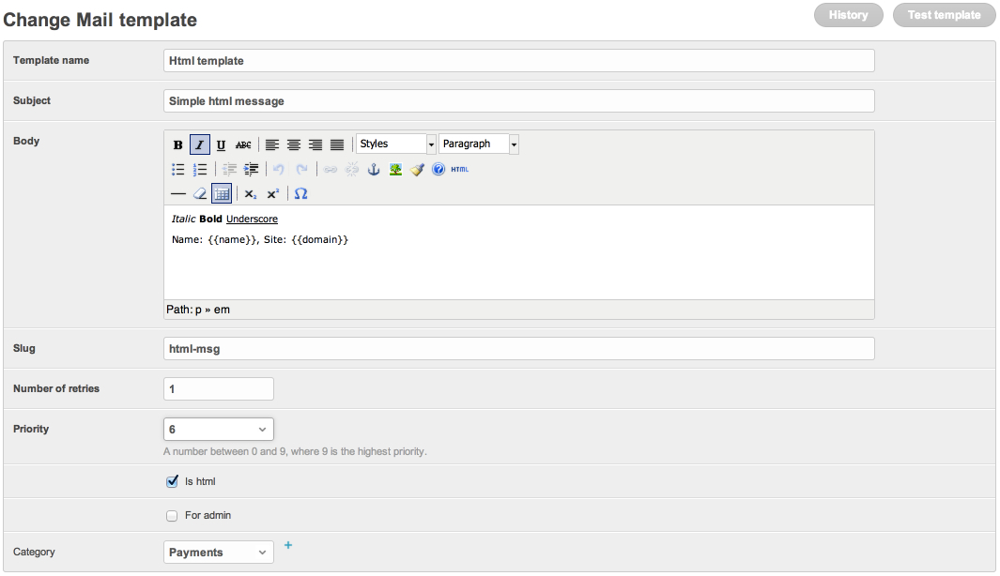
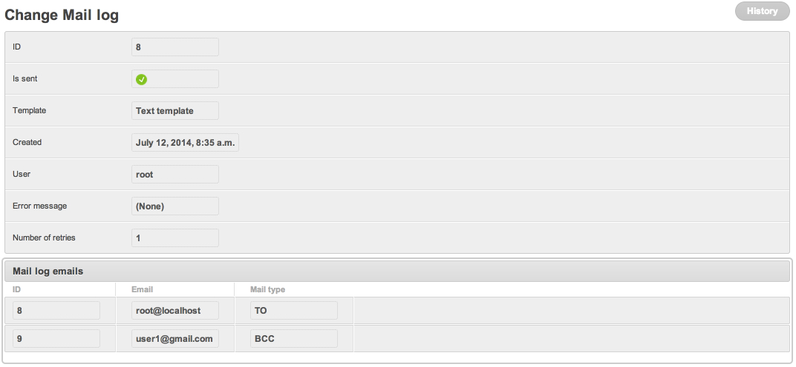

# Your first mail in 5 minutes

By the end of this tutorial you will have:

- A `MailTemplate` row managed via the Django admin.
- A real send through Django's locmem backend (no SMTP server
  required).
- A row in `MailLog` you can inspect.

## Prerequisites

You finished the [3-minute install](01_install.md), the demo project
or your own runs `python manage.py runserver` cleanly.

## 1. Configure email backend

For local testing, route mails to `django.core.mail.outbox`:

```python
# settings.py
EMAIL_BACKEND = "django.core.mail.backends.locmem.EmailBackend"
DEFAULT_FROM_EMAIL = "demo@example.com"
```

For production swap to SMTP (`django.core.mail.backends.smtp.EmailBackend`)
or `django-anymail`'s SES/Postmark/Mailgun backend.

## 2. Create a sender + template

You can do this in admin or via shell. Shell is faster:

```python
# python manage.py shell_plus
from dbmail.models import MailFromEmail, MailTemplate

sender = MailFromEmail.objects.create(name="App", email="app@example.com")

MailTemplate.objects.create(
    name="Welcome — first hello",
    subject="Welcome, {{user}}!",
    message="""
        <h1>Hi, {{user}}</h1>
        <p>Glad you joined. Your plan is <b>{{plan}}</b>.</p>
        <p>Visit <a href="{{site.domain}}">our site</a>.</p>
    """,
    slug="welcome",
    is_html=True,
    from_email=sender,
)
```

Notes:

- `slug` is the public identifier you pass to `send_db_mail`.
- `subject` and `message` are Django templates. `{{ instance.* }}`
  attribute access is allowed; `` and `` are
  not (sandboxed renderer ships in 3.1 — until then **only superusers
  can edit** the body fields — see [security model](../explanation/security.md)).
- `is_html=True` enables tracking pixel injection if
  `DB_MAILER_TRACK_ENABLE = True`.

## 3. Send

```python
from dbmail import send_db_mail

send_db_mail(
    "welcome",
    "alice@example.com",
    {"user": "Alice", "plan": "Pro"},
    use_celery=False,
)
# → "OK"
```

The third positional is your context dict. `use_celery=False` runs
the send synchronously — without it, `dbmail` queues the task via
`apply_async` and the call returns immediately.

## 4. Inspect outbox

```python
from django.core import mail
print(len(mail.outbox))                      # → 1
print(mail.outbox[0].subject)                # → "Welcome, Alice!"
print(mail.outbox[0].body[:80])              # → "<h1>Hi, Alice</h1>..."
```

The template change form looks like this:



## 5. Inspect MailLog

```python
from dbmail.models import MailLog

log = MailLog.objects.order_by("-pk").first()
print(log.is_sent, log.template.slug, log.backend)
# → True welcome mail
```

`MailLog` rows are also visible in the Django admin under
`/admin/dbmail/maillog/`. You can search by recipient email, log id,
backend, template, or success status.



## 6. Multiple recipients

```python
send_db_mail("welcome", ["a@example.com", "b@example.com"], {"user": "team"}, use_celery=False)
send_db_mail("welcome", "a@example.com, b@example.com", {"user": "team"}, use_celery=False)
```

Or via a `MailGroup` (admin → Mail groups → Add):

```python
from dbmail.models import MailGroup, MailGroupEmail

g = MailGroup.objects.create(name="Subscribers", slug="subscribers")
MailGroupEmail.objects.bulk_create([
    MailGroupEmail(group=g, name="A", email="a@example.com"),
    MailGroupEmail(group=g, name="B", email="b@example.com"),
])
send_db_mail("welcome", "subscribers", {"user": "everyone"}, use_celery=False)
```

The `recipient` argument is resolved as: `MailGroup.slug` first,
then comma-separated string, then list.

## What's next

- **[03_signals.md](03_signals.md)** — fire mails automatically on
  `post_save` of any model.
- **[../api.md](../api.md)** — POST mails from another service.
- **[../reference/models.md](../reference/models.md)** — every model
  field with its meaning.
- **[../usage.md](../usage.md)** — every kwarg accepted by
  `send_db_mail` / `send_db_sms` / `send_db_push` / `send_db_tts` /
  `send_db_bot` / `send_db_subscription`.
