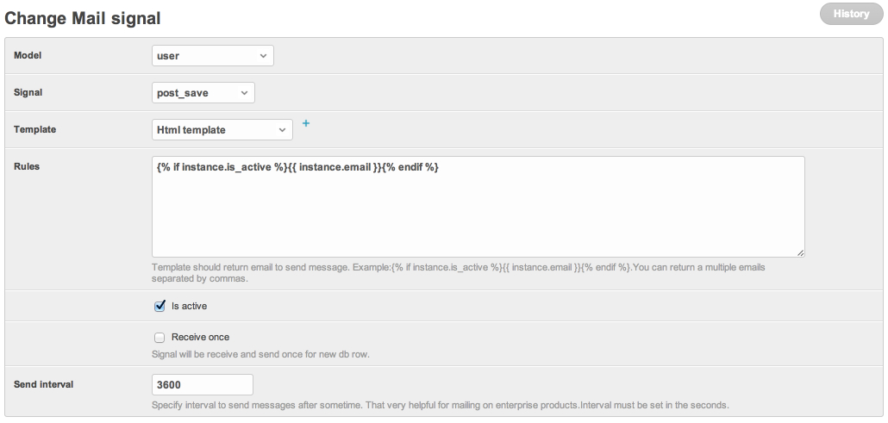
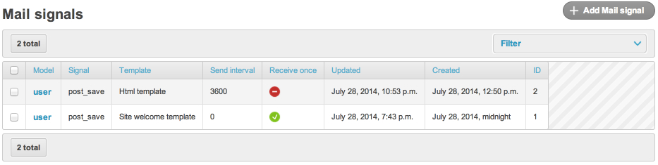

# Auto-send on model save (DB-driven Signal)

Every newly registered user should receive a welcome email. `dbmail`
ships a `Signal` model that connects Django's dispatch signals to a
template — no Python wiring required.

## Prerequisites

Finish [02_first_mail.md](02_first_mail.md). You should have a
working `MailTemplate` named `welcome`.

## 1. Create a Signal row

In the Django admin, **DBMail → Signals → Add**:

| Field | Value |
|---|---|
| Name | `Welcome on user signup` |
| Model | `auth | user` (the ContentType) |
| Signal | `post_save` |
| Template | `welcome` |
| Group | (optional MailGroup of admins to BCC) |
| Rules | empty (no extra filter) |
| Interval | `0` (send immediately; non-zero schedules deferred) |
| Receive once | yes (don't re-fire on subsequent saves) |
| Update model | no (do not stamp ``mail_sent`` on the instance) |
| Is active | yes |

> **Permission note** — only superusers can create / edit Signal rows
> by default (the `rules` field is rendered through the Django template
> engine against the model instance — same SSTI surface as
> `MailTemplate.message`). Sandbox renderer ships in 3.1.

Save. The new Signal is registered through `initial_signals()` on the
next process startup, or immediately via `dbmail.signals.initial_signals()`.



The Signals changelist shows every wired signal at a glance:



## 2. Trigger

```bash
python manage.py shell
```

```python
from django.contrib.auth import get_user_model
User = get_user_model()
User.objects.create_user(username="alice", email="alice@example.com", password="x")
```

```python
from django.core import mail
print(len(mail.outbox), mail.outbox[0].subject)
# → 1 Welcome, alice!
```

The chain:

1. `User.save()` fires Django `post_save` signal.
2. `dbmail.signals.signal_receiver` receives it (connected for the
   ContentType + signal kind from your Signal row).
3. `SignalReceiver(sender, instance, ...).run()`:
   - applies `Signal.rules` (Django-template expression evaluated
     against the instance — empty rules pass).
   - resolves recipient from the instance fields (uses `instance.email`
     by default).
   - calls `send_db_mail("welcome", instance.email, instance, ...)`.
4. `Sender` renders + queues / sends.
5. `MailLog` row written.

## 3. Optional: deferred dispatch

Set **Interval** > 0 (seconds) to delay the send. The signal handler
then writes a `SignalDeferredDispatch` row instead of dispatching
immediately. A periodic worker drains the queue:

```bash
python manage.py send_dbmail_deferred_signal
```

Schedule this with cron or Celery beat — once a minute is fine.

## 4. Optional: filter by rule

`Signal.rules` is a Django template expression that must render to
`"True"` for the send to proceed. Example:

```jinja
True
```

The handler renders the expression with the instance + the previously
saved row (`old_instance`) in context. Use this to avoid spamming on
every save when only a specific transition matters:

```jinja
True
```

## 5. Optional: stamp the instance

If you set **Update model** = yes, `dbmail` writes a flag onto the
instance after the send so you can query "users who received the
welcome". The flag field is `mail_sent` by default — add it to your
own model if you intend to use this.

## 6. Disable a Signal

Toggle **Is active** off in admin. The Django dispatch hook stays
connected for the lifetime of the process; the receiver short-circuits
on inactive Signals. For a clean disconnect, run
`dbmail.signals.initial_signals()` again (which only re-registers
active Signals, dropping the inactive one).

## 7. What can fire

The `Signal.signal` field accepts any Django dispatch signal name
declared on `django.db.models.signals` (`pre_save`, `post_save`,
`pre_delete`, `post_delete`, `m2m_changed`).

Custom signals from third-party apps (e.g. allauth's
`user_signed_up`) are **not** supported by the DB-driven flow — wire
those up explicitly in your project code and call `send_db_mail`
directly.

## What's next

- **[../api.md](../api.md)** — POST mails from another service.
- **[../reference/models.md](../reference/models.md)** — every model
  field with its meaning.
- **[../usage.md](../usage.md)** — full `send_db_*` kwargs reference.
