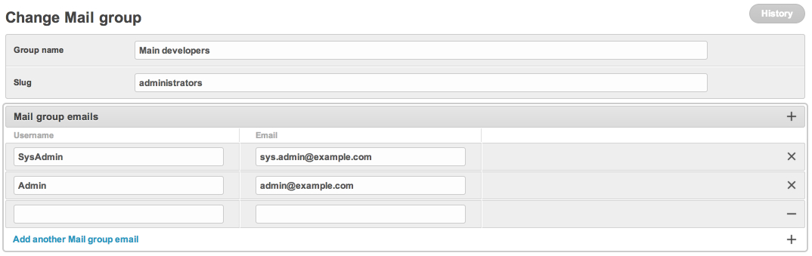

# Import a CSV into a MailGroup

`MailGroup` is the bundled list-management model — a named slug that
resolves to a list of recipients (`MailGroupEmail` rows). Once the
group has members, `send_db_mail("welcome", "your-group-slug", ...)`
fans out to every member.

There is no built-in CSV admin import in 3.0 (slated for 3.1). Until
then, use the management shell or write a one-shot script.

## Format

```csv
name,email
Alice,alice@example.com
Bob,bob@example.com
Carol,carol@example.com
```

The `email` column is required; everything else is optional. For
SMS / push, the column is still called `email` for historical
reasons — `MailGroupEmail.email` is a `CharField`, not validated as
email, so paste phone numbers / device tokens too.

The MailGroup change view in admin (members are managed inline):



## One-shot via shell

```python
import csv
from dbmail.models import MailGroup, MailGroupEmail

group, _ = MailGroup.objects.get_or_create(
    name="Subscribers",
    slug="subscribers",
)

with open("/path/to/contacts.csv", encoding="utf-8") as fh:
    reader = csv.DictReader(fh)
    rows = [
        MailGroupEmail(
            group=group,
            name=r.get("name") or r["email"],
            email=r["email"].strip(),
        )
        for r in reader
        if r.get("email")
    ]

# bulk_create avoids per-row queries
MailGroupEmail.objects.bulk_create(rows, ignore_conflicts=True, batch_size=500)
print(f"Imported {len(rows)} addresses into '{group.slug}'")
```

## Re-runnable management command

```python
# myapp/management/commands/import_subscribers.py
from __future__ import annotations

import csv
from pathlib import Path

from django.core.management.base import BaseCommand, CommandError

from dbmail.models import MailGroup, MailGroupEmail


class Command(BaseCommand):
    help = "Import a CSV (name,email) into a MailGroup."

    def add_arguments(self, parser):
        parser.add_argument("path", help="Path to the CSV file")
        parser.add_argument("--slug", required=True, help="Target MailGroup.slug")
        parser.add_argument("--name", default=None, help="MailGroup.name (auto-create)")
        parser.add_argument("--dry-run", action="store_true")

    def handle(self, *args, **opts):
        path = Path(opts["path"])
        if not path.exists():
            raise CommandError(f"{path} not found")

        group, created = MailGroup.objects.get_or_create(
            slug=opts["slug"],
            defaults={"name": opts["name"] or opts["slug"]},
        )
        if created:
            self.stdout.write(self.style.NOTICE(f"created MailGroup {group.slug!r}"))

        with path.open(encoding="utf-8") as fh:
            reader = csv.DictReader(fh)
            rows = [
                MailGroupEmail(
                    group=group,
                    name=(r.get("name") or r["email"]).strip(),
                    email=r["email"].strip(),
                )
                for r in reader
                if (r.get("email") or "").strip()
            ]

        if opts["dry_run"]:
            self.stdout.write(self.style.WARNING(f"DRY-RUN — would import {len(rows)} rows"))
            return

        MailGroupEmail.objects.bulk_create(rows, ignore_conflicts=True, batch_size=500)
        self.stdout.write(self.style.SUCCESS(f"Imported {len(rows)} addresses into {group.slug!r}"))
```

```bash
python manage.py import_subscribers contacts.csv --slug subscribers --name "Subscribers"
```

`ignore_conflicts=True` skips duplicates without raising — safe to
re-run on the same file. Combine with a `--prune` flag if you want to
delete addresses that disappeared from the source.

## Sending to the imported group

```python
from dbmail import send_db_mail

# Recipient resolved as MailGroup.slug because it has no @ or +
send_db_mail("welcome", "subscribers", {"campaign": "September"})
```

For huge groups (>10 k members) prefer Celery — the `dbmail` Sender
runs serially per recipient by default (PERF-1 batch optimisation
ships in 3.0.1).

## Cache

`MailGroup.get_emails(slug)` materialises the address list and caches
it under the slug. After import, call:

```python
from dbmail.models import MailGroup
MailGroup(slug="subscribers").clean_cache()
```

…or wait for `MailGroup.save()` to fire (the post-import script does
not modify the parent group).

## See also

- [reference/models.md](../reference/models.md#mailgroup) — fields.
- [usage.md](../usage.md#subscription-api) — opt-in/out via
  `MailSubscription` (alternative to bulk import).
