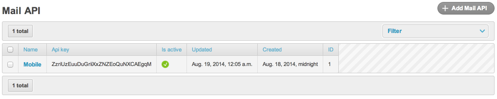

# Rotate an API key

Every public `ApiKey` should be rotated periodically: on credential
leak, when the holder leaves, or on a fixed schedule (90 days is a
sensible default).

`dbmail` exposes two admin actions and a Django shell path. Both
preserve the row identity (foreign keys to `MailLog.user` etc. stay
intact); only `ApiKey.api_key` and `ApiKey.password_hash` change.

## Via admin

1. Open `/admin/dbmail/apikey/`.
2. Tick the keys to rotate.
3. **Action menu → "Rotate selected API keys"** → Go.
4. The success message lists the new raw values once — copy them
   immediately. After the page redirects the keys are masked.



The `rotate_api_key` action calls `secrets.token_urlsafe(24)[:32]`
per row, sets `api_key=<new>`, blanks `password_hash`, and saves.
`save_model` re-hashes on the next request.

## Via shell

```python
import secrets
from dbmail.models import ApiKey

key = ApiKey.objects.get(name="my-app")
new_raw = secrets.token_urlsafe(24)[:32]
key.api_key = new_raw
key.password_hash = ""    # forces re-hash on save
key.save()
print("New raw key:", new_raw)
```

`ApiKey.save()` repopulates `password_hash` from `api_key` if the
hash is empty — see `dbmail/models.py:ApiKey.save`.

## Zero-downtime rotation (two clients sharing one key)

If a single ApiKey row is shared between two services and you want
zero downtime:

1. **Add** a second ApiKey row (`name="my-app-rotation"`) with a new
   raw value. Hand it to one service first.
2. **Wait** until that service is fully on the new key (verify via
   `last_used_at` on the old row).
3. Hand the new key to the second service.
4. **Revoke** the old row: tick it in admin, **Action → "Revoke
   selected API keys"** (sets `is_active=False` — does **not**
   delete, so audit history is preserved).
5. After 30 days delete the revoked row entirely.

This avoids the cache-invalidation race that a single-row rotate
would create — the old hashed key is cached until `DB_MAILER_CACHE_TTL`
expires; until then both old and new authenticate.

## Cache invalidation

`ApiKey.save()` clears the per-key cache entry
(`dbmail:apikey:<sha256(raw)>`) so the next request re-validates
against the new hash. If you rotate via raw SQL `UPDATE` (not
recommended), call:

```python
from dbmail.models import ApiKey
ApiKey.clean_cache()
```

…to wipe the entire `dbmail:apikey:*` namespace.

## Audit

`ApiKey.last_used_at` and `last_used_ip` are populated on every
successful authentication (cache miss). After rotation, these reset
to `None` until the new key is used.

`MailLog.user` references the Django user, not the ApiKey — there is
no historical link from `MailLog` to "this row was sent under
which key". If you need that, log it in a custom Sender override or
post-save signal on `MailLog`.

## See also

- [api.md](../api.md) — endpoint reference.
- [Security model](../explanation/security.md) — credential storage and
  scheduled removal of the legacy plain `api_key` column in `4.0`.
