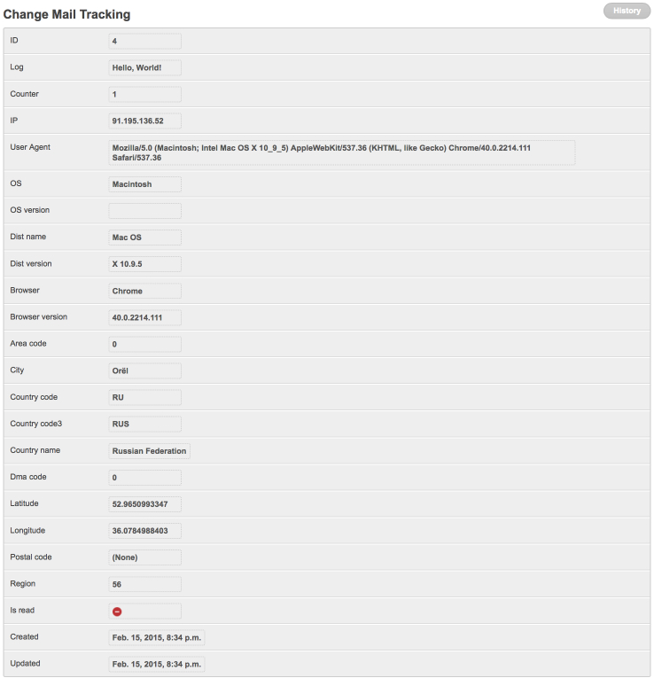

# Track opens with the embedded pixel

`dbmail` injects a 1×1 transparent GIF into HTML messages when both
`DB_MAILER_TRACK_ENABLE = True` and `DB_MAILER_ENABLE_LOGGING = True`.
When the recipient opens the email, the client requests the pixel,
the request hits a public dbmail endpoint, and a `MailLogTrack` row
is written.

## Enable

```python
# settings.py
DB_MAILER_TRACK_ENABLE = True
DB_MAILER_ENABLE_LOGGING = True
```

The Site framework must resolve to a real domain (`Site.objects.get_current()`)
because the pixel URL is built off it. In production set `SITE_ID`
properly and update the row in `/admin/sites/site/`.

The template **must be HTML** (`MailTemplate.is_html = True`). Plain-
text mails carry no pixel and produce no `MailLogTrack` rows.

URL routes must be mounted (default is `/dbmail/...`):

```python
# urls.py
from django.urls import include, path

urlpatterns = [
    ...,
    path("dbmail/", include("dbmail.urls", namespace="dbmail")),
]
```

## What gets recorded

Every open writes / increments a row in `MailLogTrack` (see
[reference/models.md](../reference/models.md#maillogtrack)):

- `mail_log` (FK to MailLog)
- `counter` — open count (incremented on every reload)
- `is_read` — flipped to `True` on first hit
- `ip` — resolved via `django-ipware` (honours XFF + IPWARE_TRUSTED_PROXY_LIST)
- `user_agent` raw + parsed (`os`, `os_version`, `dist_name`,
  `dist_version`, `browser`, `browser_version`) — populated only if
  `httpagentparser` is installed: `pip install "django-db-mailer[tracking]"`
- GeoIP fields (`country_name`, `country_code`, `city`, `region`,
  `latitude`, `longitude`, `postal_code`, `area_code`, `dma_code`) —
  populated only if `geoip2` + a MaxMind database is configured.

The MailLogTrack change view aggregates the open events per
`MailLog`:



## Querying open rates

```python
from dbmail.models import MailLog, MailLogTrack
from django.db.models import Count, F

# Per-template open rate
qs = (MailLog.objects.filter(is_sent=True)
      .annotate(opens=Count("maillogtrack"))
      .values("template__slug")
      .annotate(total=Count("id"), opened=Count("maillogtrack"))
      .order_by("-total"))

for row in qs:
    rate = (row["opened"] / row["total"]) * 100 if row["total"] else 0
    print(f"{row['template__slug']:30s} sent={row['total']:5d} "
          f"opens={row['opened']:5d} rate={rate:.1f}%")
```

```python
# Recent opens per recipient
recent = (MailLogTrack.objects
          .select_related("mail_log__template")
          .order_by("-updated")[:50])

for t in recent:
    print(t.updated, t.ip, t.mail_log.template.slug, t.counter)
```

## Privacy / GDPR

`MailLogTrack` stores PII (IP + UA + GeoIP). The pixel URL itself
encrypts only the `mail_log` id (Django `signing.dumps`) — the
recipient address is **not** in the URL.

For GDPR / data retention compliance, run the cleanup management
command on a schedule:

```bash
# every night, drop tracking rows older than DB_MAILER_LOGS_EXPIRE_DAYS
python manage.py clean_dbmail_logs
```

`DB_MAILER_LOGS_EXPIRE_DAYS` defaults to `7`. Bump it to your
retention policy (e.g. `30` or `90`).

For the threat model and PII-retention guidance, see
[security model](../explanation/security.md).

## Testing

```python
# tests/test_tracker.py
from django.test import Client
from django.urls import reverse
from django.core import signing
from dbmail.models import MailLog


def test_pixel_returns_gif(db, settings):
    settings.DB_MAILER_TRACK_ENABLE = True
    settings.DB_MAILER_ENABLE_LOGGING = True
    settings.ROOT_URLCONF = "tests.urls_admin"

    log = MailLog.objects.create(template=..., is_sent=True)
    encrypted = signing.dumps(log.id)
    url = reverse("dbmail:db-mail-tracker", args=[encrypted])

    resp = Client().get(url)
    assert resp.status_code == 200
    assert resp.content[:6] == b"GIF89a"
    assert len(resp.content) == 43
```

## Disabling for one template

If a particular template should not be tracked (e.g. password reset
links), set `MailTemplate.enable_log = False` (the pixel will not be
injected because no log id is reserved for the send). Project-level
disable is `DB_MAILER_TRACK_ENABLE = False`.

## See also

- [reference/models.md](../reference/models.md#maillogtrack) — full
  field list.
- [settings.md](../settings.md) — tracking section.
- [Security model](../explanation/security.md) — PII retention policy.
