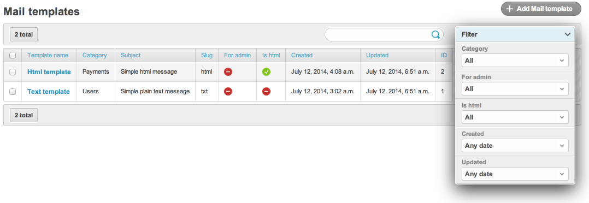

# Installation

## Compatibility

`django-db-mailer 3.0` supports the following matrix (verified by tox
on every release; see `tox.ini`):

| Python | Django |
|---|---|
| 3.10, 3.11, 3.12 | 4.2 LTS, 5.2 LTS |
| 3.13, 3.14 | 5.2 LTS, 6.0 |

PyPy is **not** supported. Python ≤ 3.9 and Django ≤ 4.1 are dropped
from `3.0` — stay on the `2.4.x` line if you cannot upgrade your
runtime.

## Install

```bash
pip install -U django-db-mailer
```

For provider SDKs, install the matching extra (lazy-imported, only
the providers you actually use):

```bash
pip install "django-db-mailer[apns]"          # apple/apns2 (HTTP/2 push)
pip install "django-db-mailer[fcm]"           # firebase / google
pip install "django-db-mailer[twilio]"        # twilio SMS
pip install "django-db-mailer[pubnub]"        # pubnub>=7
pip install "django-db-mailer[vonage]"        # vonage
pip install "django-db-mailer[brevo]"         # Brevo (ex-Sendinblue)
pip install "django-db-mailer[webpush]"       # pywebpush
pip install "django-db-mailer[html]"          # html2text + premailer
pip install "django-db-mailer[tracking]"      # httpagentparser
pip install "django-db-mailer[celery]"        # celery+redis
pip install "django-db-mailer[all-providers]" # everything
```

Static assets must be collected on production:

```bash
python manage.py collectstatic
```

## Django settings

```python
INSTALLED_APPS = [
    ...
    "django.contrib.sites",
    "dbmail",
    ...
]
SITE_ID = 1
```

The `Site` framework is required — `dbmail` reads
`Site.objects.get_current()` for tracking pixel URL generation and the
context dictionary passed to template rendering.

Mount the URLs (the routes are namespaced under `dbmail:`):

```python
# urls.py
from django.urls import include, path

urlpatterns = [
    ...
    path("dbmail/", include("dbmail.urls", namespace="dbmail")),
]
```

## Database

```bash
python manage.py migrate
```

`3.0` ships with two migrations — `0001_initial.py` (final schema) and
`0002_apikey_hash_data.py` (a backfill that hashes any pre-3.0 plain
`ApiKey` rows). Both are no-ops on a fresh install.

If you are upgrading from a `2.x` codebase **stay on 2.4.x** — there
is no automated 2.x → 3.0 migration path. See
[MIGRATION.md](../MIGRATION.md) for the rationale and the optional
manual `dumpdata`/`loaddata` recipe.

## Optional integrations

`dbmail` plays well with several third-party Django apps if they are
installed and listed in `INSTALLED_APPS`. None is required.

```python
INSTALLED_APPS = [
    ...
    "ckeditor",                       # rich-text widget for MailTemplate.message
    # or "tinymce",                   # alternative rich-text widget
    "modeltranslation",               # multilingual MailTemplate
    "grappelli",                      # admin theme
    "reversion",                      # admin history
    "reversion_compare",              # admin diff view
    ...
]
```

The HTML widget is selected at import time — if `tinymce` is in
`INSTALLED_APPS` it wins; otherwise `ckeditor`; otherwise the column is
a plain `TextField`. The schema is always `TEXT` regardless, so you
can swap the widget any time without a migration.

## What admin looks like

After `migrate`, the dbmail section appears in `/admin/dbmail/`:



## Verifying the install

```python
# Django shell
from dbmail import send_db_mail
from dbmail.models import MailFromEmail, MailTemplate

sender = MailFromEmail.objects.create(name="from", email="from@example.com")
MailTemplate.objects.create(
    name="Welcome",
    subject="Welcome {{user}}",
    slug="welcome",
    message="Hello {{user}}",
    is_html=False,
    from_email=sender,
)

send_db_mail("welcome", "you@example.com", {"user": "Alice"}, use_celery=False)
# → "OK"
```

If the call returns `"OK"` and an entry appears in the Django admin
under `Mail logs`, the install is complete. Continue with the
[5-minute tutorial](getting_started/02_first_mail.md).

## Next steps

- [Quick start](getting_started/01_install.md) — your first template
  in 5 minutes.
- [Settings reference](settings.md) — every `DB_MAILER_*` knob.
- [Public API endpoint](api.md) — POST a mail from another service.
- [Web Push](web_push.md) — Safari + browser push subscriptions.
